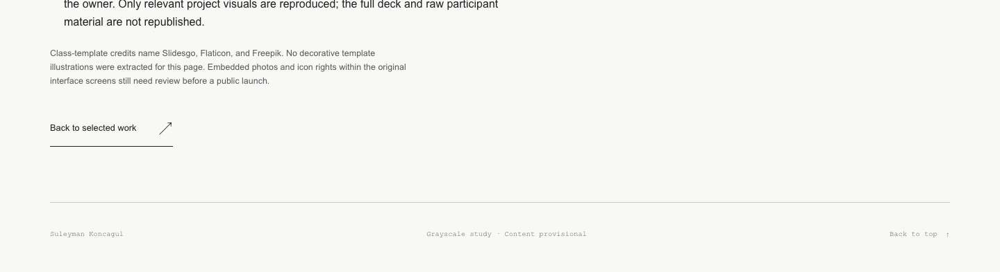

# Full-page desktop review capture

Viewport width: 1440px. Consecutive, unedited browser-capture strips cover the entire page from navigation to footer. Split only to fit the GitHub connector transport limit. The single-image full-resolution capture is also delivered in chat.

