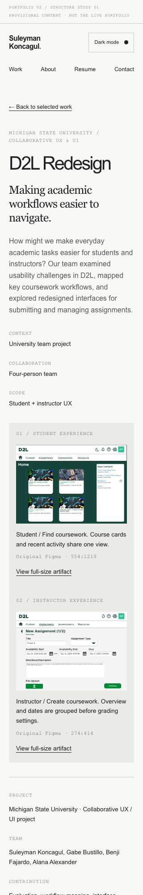
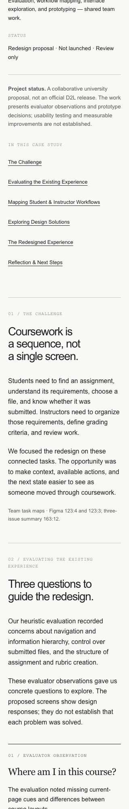
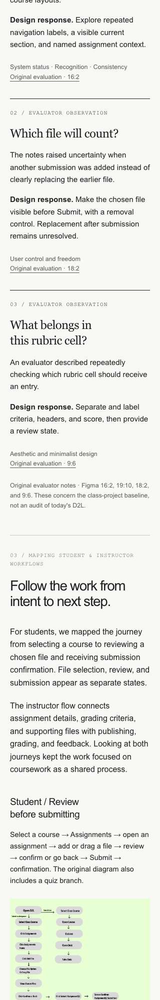
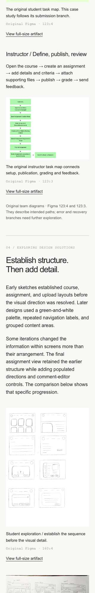
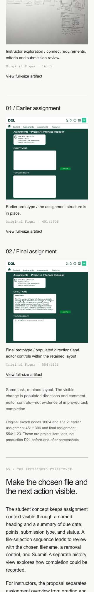
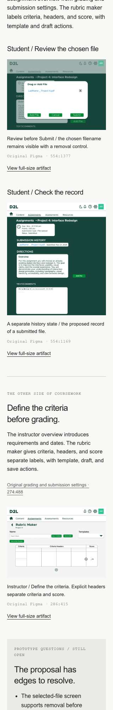
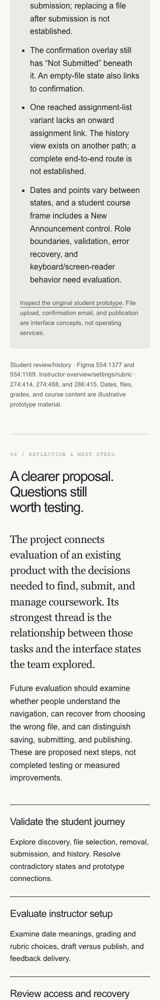
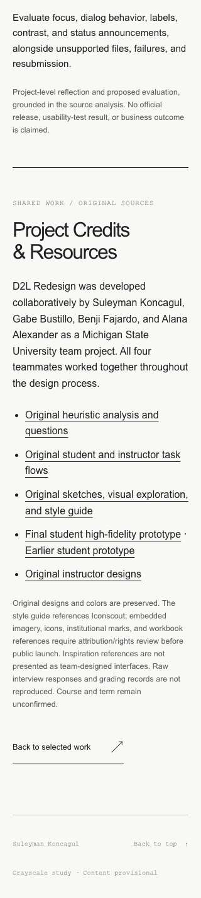

# D2L Redesign — full-page review at 320px

Consecutive browser-capture strips cover the complete page. These document the portfolio implementation, not research or prototype usability results.

